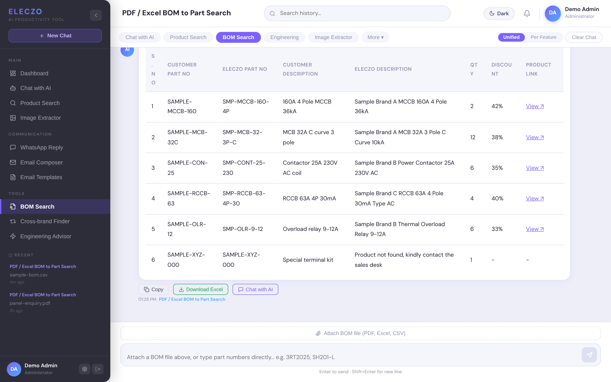
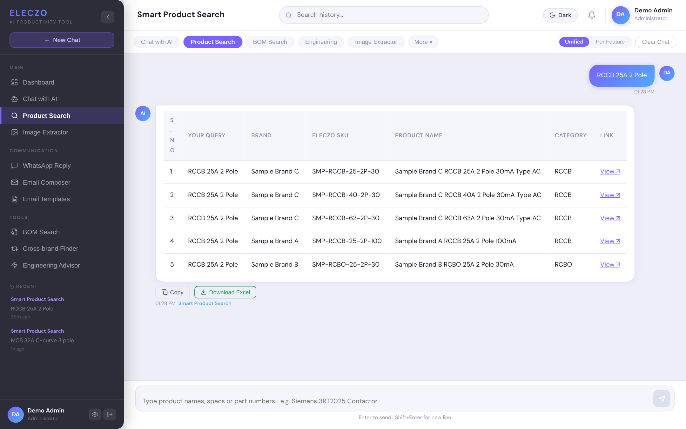
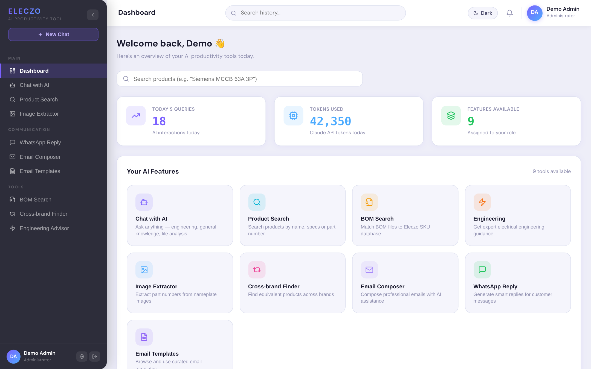
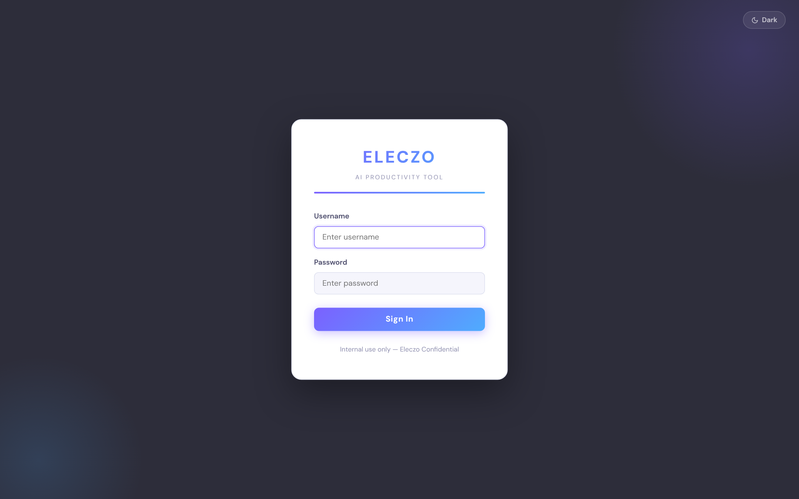
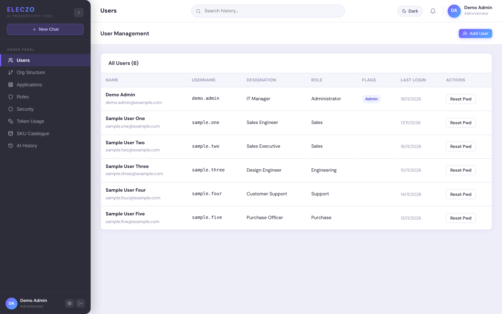
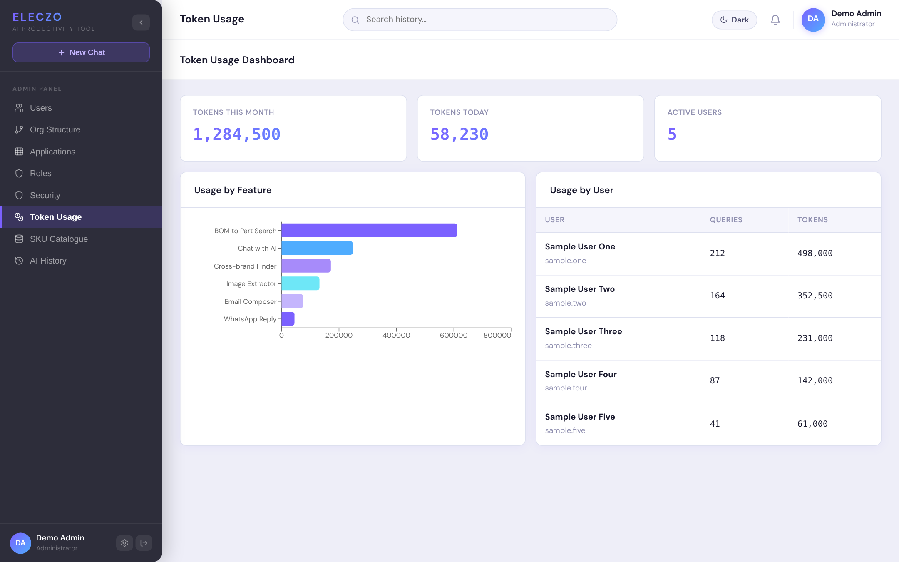
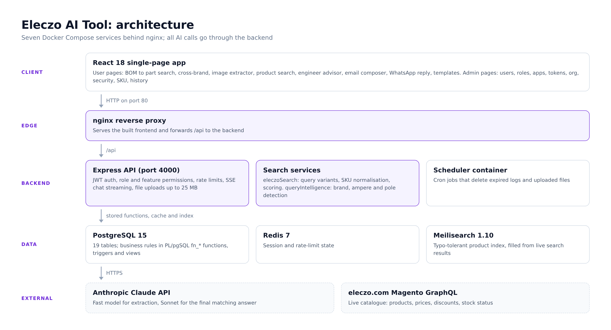
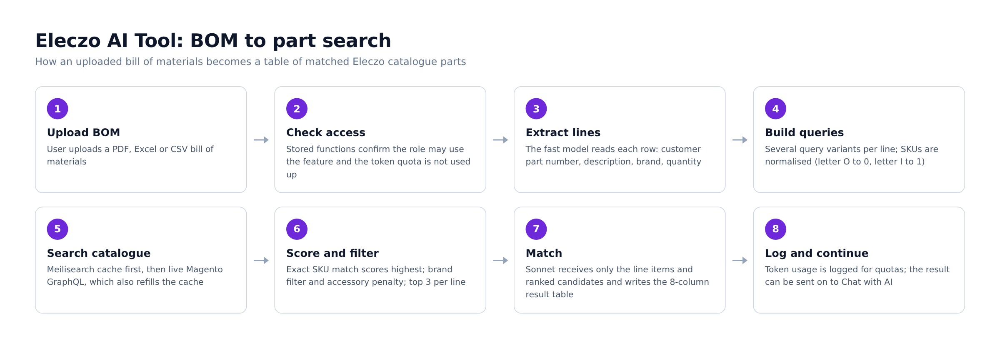

# Eleczo AI Tool (V2): AI Workspace for Sales and Engineering

An internal AI workspace for an electrical-products distributor, built at Eleczo India Pvt. Ltd. Its main feature turns a customer's bill of materials (BOM) into a table of matching catalogue parts with product links. It also includes smaller AI tools for sales and engineering staff, all behind role-based access and usage quotas.

> **Showcase repository.** This repo contains documentation only. The source code is private because it belongs to my employer. Screenshots use sample data and sample brand names.

## Screenshots

**BOM to part search.** Upload a PDF, Excel or CSV BOM and get matched catalogue parts, quantities, discounts and product links. Lines with no match are marked clearly instead of guessed.

**Smart product search.** Catalogue search by name, spec or part number, with an Excel download of the results.

**Dashboard and sign-in**

  
  

**Admin: users and token usage**

  
  

## At a glance

| | |
|---|---|
| **Type** | Internal AI web application |
| **Frontend** | React 18, React Router, Axios, Recharts |
| **Backend** | Node.js 18, Express 4 |
| **AI** | Anthropic Claude through the official SDK (a fast model for extraction, Sonnet for final answers) |
| **Database** | PostgreSQL 15 with business logic in PL/pgSQL functions |
| **Cache and search** | Redis 7, Meilisearch 1.10 |
| **Catalogue source** | Company storefront (Magento GraphQL) |
| **Deployment** | Docker Compose, seven services, nginx on port 80 |

## The problem

Sales staff receive BOMs as PDFs, spreadsheets and photos, each written in the customer's own part numbers and descriptions. Matching every line to the right catalogue product by hand is slow, and a wrong match means a wrong quote. The company also wanted AI help for everyday writing and product questions, but with control over who can use what and how much it costs.

## What I built

**User features**

- **PDF / Excel BOM to part search.** Upload a BOM and get an 8-column table: customer part number and description, Eleczo part number and description, quantity, discount and product link.
- **Cross-brand search.** Find equivalents of a part in other brands, marked as exact or functional equivalents.
- **Image extractor.** Read part details from a photo.
- **Product search.** Fast catalogue search with autocomplete and typo tolerance.
- **Engineering advisor, email composer, WhatsApp reply generator and a template library.**
- **Chat with AI**, with BOM results carried across in one click.

**Admin features**

- Users, roles and per-feature permissions.
- Apps and sub-apps, where each feature's system prompt, output format and token limit are stored and edited.
- Token usage and quotas, organisation chart, security settings, SKU management and interaction history.

## Architecture

## How the BOM search works

## Technical highlights

- **Two-model pipeline.** A fast model extracts the line items from the file; Sonnet does the final matching. The final call receives only the extracted lines and the ranked candidates, not the original file again, which roughly halves input tokens on multi-page PDFs.
- **Hybrid SKU and description search.** Each BOM line is classified (brand, product type, rating, pole count) and expanded into several focused queries.
- **SKU normalisation.** Vision extraction often confuses letter O with zero and letter I with one. Part codes are normalised so that a misread code still matches the catalogue's real one.
- **Scoring with guard rails.** An exact normalised SKU match scores highest. Product type, brand, rating and poles add points. Accessories lose points unless the user asked for one, because the storefront search often ranks accessories above main products. SKU-like inputs must match exactly, to avoid wrong links.
- **Brand-strict filtering.** When the BOM has a Make column, candidates of other brands are dropped; an empty row is better than a wrong brand.
- **Search cache that fills itself.** Every live GraphQL result is written to Meilisearch in the background, so repeated and similar queries return instantly. If Meilisearch is down, the routes fall back to live search.
- **Logic in the database.** Permissions, quota checks and interaction logging are PL/pgSQL functions, so the rules are enforced in one place regardless of which route calls them.
- **Cost and access control.** Quotas are checked before every AI call and token usage is logged after it. Logs and uploaded files expire automatically through a scheduler container.
- **Security basics.** JWT with refresh tokens, rate limiting (stricter on login), Helmet headers, and the API key held only by the backend.

## Known limitations and next steps

- Description-only BOM lines are best-effort, because the storefront search does not always return the main product. A local product catalogue or category-filtered queries would fix this at the source.
- There is no automated test suite or linter yet.
- Database init scripts only run on a fresh volume, so schema changes on a live system are applied by hand.

## Skills demonstrated

LLM application design (prompting, multi-model pipelines, token budgeting, streaming), search relevance and ranking, Node.js and Express APIs, React, PostgreSQL and PL/pgSQL, Redis, Meilisearch, GraphQL integration, role-based access control, Docker Compose and nginx.

## Contact

- Email: deepatil0212@gmail.com
- LinkedIn: [linkedin.com/in/deepa-patil-332925345](https://www.linkedin.com/in/deepa-patil-332925345)
